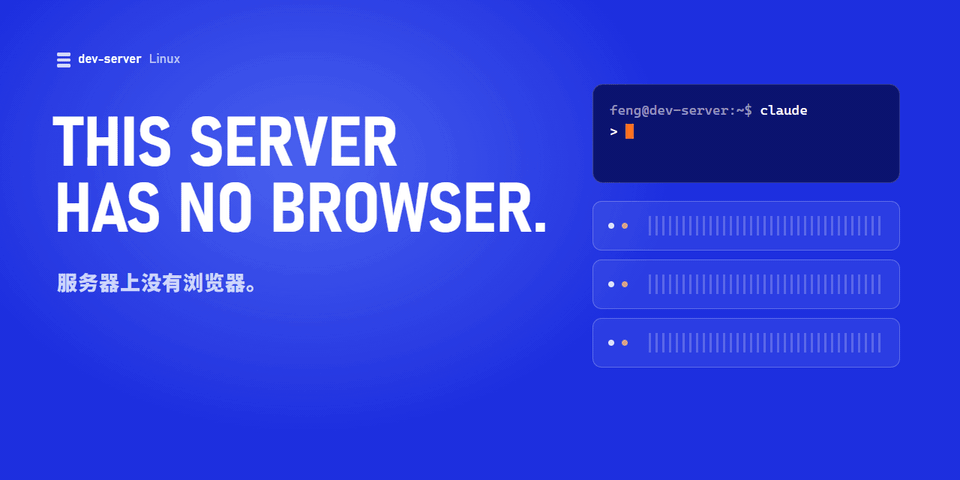
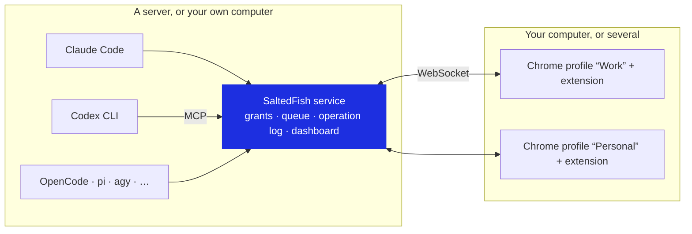
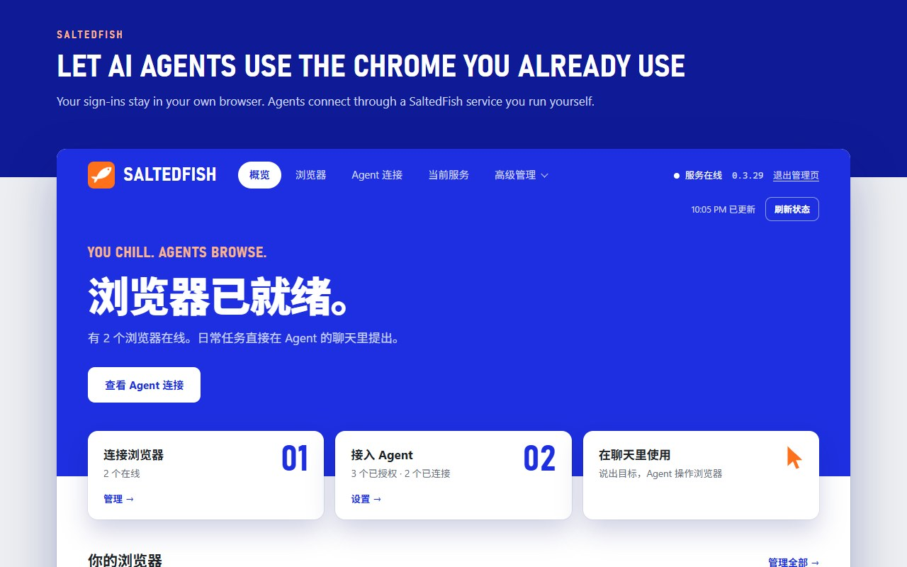
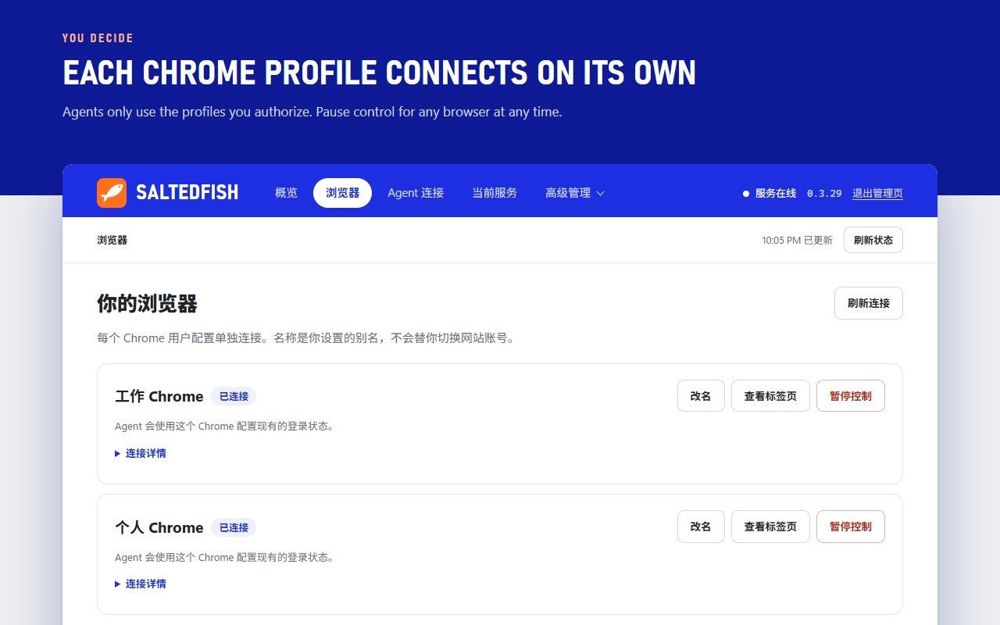
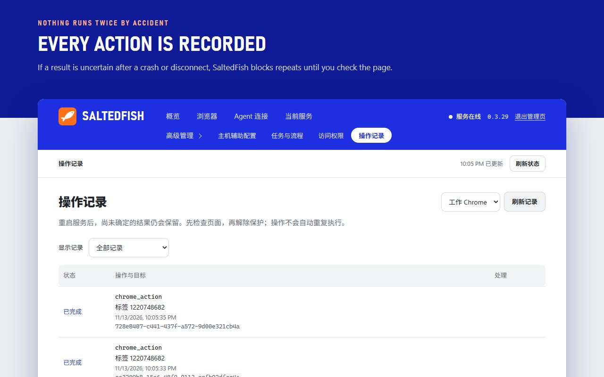

# SaltedFish

<p align="center">
  
</p>

<p align="center">
  <a href="https://www.npmjs.com/package/saltedfish"></a>
  <a href="https://github.com/finmoor/saltedfish/actions/workflows/ci.yml"></a>
  
  
  <a href="LICENSE"></a>
</p>

<p align="center">
  <a href="README.md">中文</a> · <b>English</b> · <a href="#quick-start">Quick start</a> · <a href="#how-it-works">How it works</a> · <a href="#security-and-data">Security</a> · <a href="#known-limitations">Limitations</a>
</p>

SaltedFish is an unrestricted browser tool: any AI agent that speaks MCP can use **the Chrome you already use**, even when the agent runs on a server.

> Most of the documentation under `docs/` is in Chinese. Issues and pull requests in English are welcome.

## Why SaltedFish

The extensions bundled with ChatGPT, Claude and WorkBuddy can use your sign-ins too, but they only serve their own agent and limit which sites it may touch. SaltedFish is a tool you run yourself:

<table>
<tr>
<td width="50%" valign="top">

**No restrictions**

No site list, no blocked actions. What an agent may touch, and how far it may go, is up to your grant.

</td>
<td width="50%" valign="top">

**Agents on a server drive the Chrome on your desk**

A headless server needs no browser and no sign-ins. Agents run on the server and click through the signed-in pages in your desktop Chrome. Chrome on several computers can join, and agents pick one by name.

</td>
</tr>
<tr>
<td valign="top">

**Human-like input**

It is your real browser and your real profile. The mouse moves along curves, clicks pause and hold, short text is typed key by key, and nothing is added to the page, which lowers the risk of being flagged and banned.

</td>
<td valign="top">

**Any agent, any model**

Any agent that speaks MCP can connect, eight of them with one command. Several can work at once.

</td>
</tr>
</table>

| | Vendor extensions | Automation browser | SaltedFish |
| --- | --- | --- | --- |
| Sites it can touch | Vendor decides; some block finance by default | Any | Any, as you grant |
| Agents on a server | Not supported | Browser must live on the server too | Drive the Chrome on your computer |
| Your sign-ins | Yes | No | Yes |
| Agents it serves | The vendor's own | Depends on the framework | Any MCP client |
| Several agents at once | Only the vendor's one | One browser each | Separate grants and tab groups |

The basics are covered too:

- **Accounts never mix.** Each Chrome profile is paired on its own; an offline profile fails instead of running on another account.
- **Stays out of your way.** Agents work in background tabs, inside their own tab group.
- **No replays.** A write with an unknown result blocks further writes; submits and payments are never retried automatically.
- **Fewer tokens.** Action results include what changed on the page; `chrome_batch` runs several steps in one call.
- **Your data stays with you.** Self-hosted, no telemetry; each agent can be limited to profiles, made read-only or revoked.

## Quick start

Requires Node.js 24+ and Chrome. Current version: **0.3.30**.

```sh
npm install -g saltedfish
saltedfish install
```

`install` starts the service, connects the agents on this computer, and prints the extension folder. Then:

1. **Load the extension.** Open `chrome://extensions`, turn on Developer mode, choose "Load unpacked" and select the printed folder.
2. **Pair it.** `saltedfish dashboard` opens the dashboard; create a pairing code under "Browsers" and paste it into the extension.
3. **Use it.** Start a new session in your agent, for example:

> Use SaltedFish. List the browser profiles, find "Work", and only use that profile. Open a new tab for the task and check the result on the page when you are done.

### Agents on a server, Chrome on your desk

Run the same two commands on a Linux server (it listens on the LAN IP, port 18445 by default), then `saltedfish dashboard`. Open the link it prints on your own computer, create a pairing code, download the extension, load it into Chrome and paste the code.

Agents must run on the same machine as the service. A LAN uses plain HTTP; add a certificate to cross the public internet. See the [install guide](docs/npm.md) (Chinese).

### Everyday commands

```sh
saltedfish status          # service status
saltedfish dashboard       # open the dashboard (one-time login code, valid for 5 minutes)
saltedfish connect         # connect local agents; --trust-browser skips per-call approval
saltedfish upgrade         # download and switch to the latest release, rolling back on failure
saltedfish rollback        # switch back to the previous compatible version
saltedfish logs --lines 100
```

## How it works



Agents connect to the service's MCP endpoint, the extension dials out to the service, and the service handles authorization, queuing, the operation log and recovery. On Windows and macOS the service listens on localhost only; on Linux it listens on the LAN IP so Chrome on other computers can connect. The agent endpoint `/mcp` only accepts connections from the machine the service runs on.

## Handing it to an agent

1. `chrome_profiles` to pick the profile, `chrome_tabs` to see its tabs.
2. Writes are limited to the session's tab group: tabs opened with `chrome_new_tab` can be used directly, existing tabs need `chrome_claim_tab` first. Reads are not limited.
3. `chrome_inspect` and `chrome_find` read the page and locate elements, `chrome_action` clicks and types. If `pageChange` in the result already shows the outcome, there is no need to read the page again.
4. Hand deterministic multi-step work to `chrome_batch`; it stops at the first failure.

<details>
<summary><code>chrome_batch</code> example</summary>

```json
{
  "profileId": "the profile ID you picked",
  "tabId": 123,
  "steps": [
    { "operation": "page.action", "args": { "action": "fill", "selector": "#name", "text": "Example" } },
    { "operation": "page.action", "args": { "action": "click", "selector": "#preview" } },
    { "operation": "page.wait", "args": { "selector": ".preview-ready" } }
  ],
  "timeoutMs": 60000
}
```

</details>

A completed click only means the input events were sent; confirm business results on the page or in network responses.

There are 64 tools, 46 listed by default; the rest appear after enabling "advanced tools" for that agent in the dashboard. Schemas live in [src/tools.ts](src/tools.ts).

## Dashboard

Pairing browsers, granting agents, tab groups and the operation log all live in `saltedfish dashboard`. Its UI is currently in Chinese.

<table>
<tr>
<td width="33%"></td>
<td width="33%"></td>
<td width="33%"></td>
</tr>
<tr>
<td align="center">Overview</td>
<td align="center">Browsers</td>
<td align="center">Operation log</td>
</tr>
</table>

## Capabilities

| Area | What it covers |
| --- | --- |
| Profiles | Explicit `profileId + tabId` routing; one persistent identity per Chrome profile |
| Collaboration | Per-agent grants that can be limited to profiles, made read-only or revoked; tab groups, tab leases, a per-window queue for visual actions |
| Pages | Text, elements, accessibility tree, screenshots, page scripts, the CDP domains available to Chrome extensions; a script injected before navigation (`initScript`) |
| Complex UI | Open Shadow DOM, same-origin and cross-origin iframes, JavaScript dialogs, styled dropdowns |
| Network and files | Network events, response bodies, waiting for a response, uploads, downloads and their completion state |
| Input | The agent cursor is drawn outside the page; optional human-like input (mouse paths, per-key typing) for pages that depend on hover, hold and drag timing |
| Recovery | Operations are written to SQLite before dispatch; the protection survives a killed process or a restart |
| Large results | Big JSON and images are saved to disk and read page by page |
| Taking over | Pause from the extension; stopping debugging by hand in Chrome pauses the connection and it is not taken back automatically |
| Upgrades | `saltedfish upgrade` rolls back if the switch fails; an unpacked extension updates with one click from its settings page and keeps its pairing |

## Security and data

- The service checks Host, Origin and credentials. The extension and the service authenticate each other with a challenge–response handshake; the pairing secret never goes over the wire.
- Grants restrict this service's API; they are not an operating-system sandbox. An authorized agent can click, type, read pages and run page scripts in the granted profiles as the signed-in user, and with "trust once" it no longer asks for each call. Grant only the profiles that are needed and revoke when done.
- Non-admin agents cannot read or write SaltedFish's data directory or network shares, cannot open `file:` URLs, and cannot operate the dashboard. Access to other local files is decided by the agent's own permission settings.
- No telemetry. Page content and screenshots returned by tools go to the agent that called them, and from there to whatever model service that agent uses.
- The operation log stores tool names, targets, times and states, not scripts, page text or file contents.

See [PRIVACY.md](PRIVACY.md). Please report vulnerabilities privately as described in [SECURITY.md](SECURITY.md).

## Known limitations

- Verified on Windows and Linux; macOS distribution is not verified.
- "Unrestricted" describes SaltedFish as a tool. The rules and approvals of the model and client behind an agent are not its to change.
- No automation guarantees for Chrome internal pages, other extensions' pages, native OS windows, CAPTCHAs or OS permission dialogs.
- Web pages can observe the DOM and input events; SaltedFish does not promise that sites cannot tell automation apart from a person.
- While an agent is connected, Chrome shows a "being debugged" bar on every tab. Starting Chrome with `--silent-debugger-extension-api` removes it; see the install guide for the trade-offs.
- Chrome's debugger API can conflict with DevTools and other extensions, and some CDP domains are not available to extensions.
- Actions that were already sent cannot be undone. Editing the page by hand while a task runs can affect the result; pause the extension before taking over.

## Contributing

See [CONTRIBUTING.md](CONTRIBUTING.md) and [docs/testing.md](docs/testing.md).

```sh
npm ci
npm run build
npm run typecheck
npm test
```

## License

[MIT](LICENSE). Third-party licenses are listed in [THIRD_PARTY_NOTICES.md](THIRD_PARTY_NOTICES.md).
