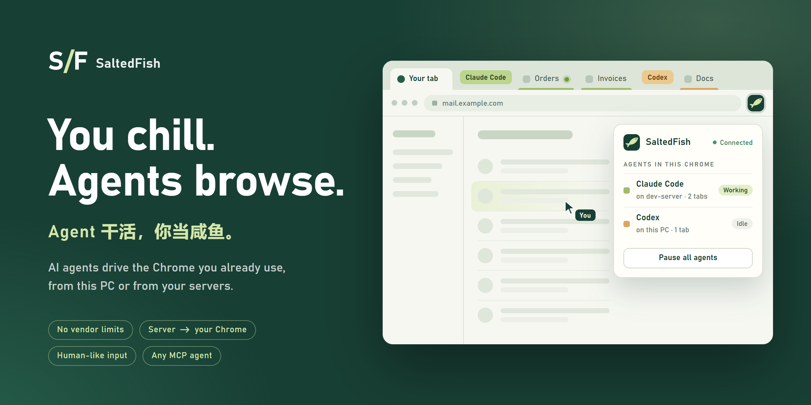
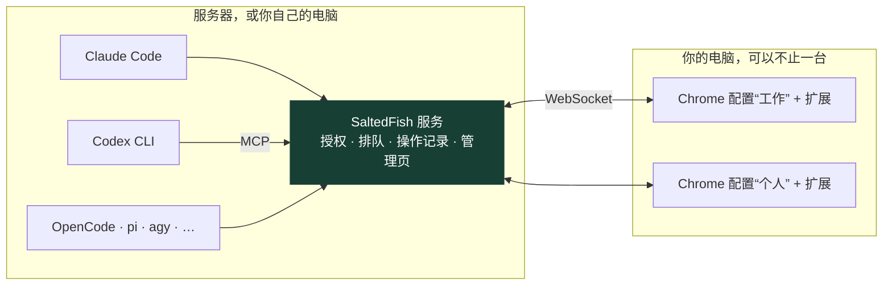
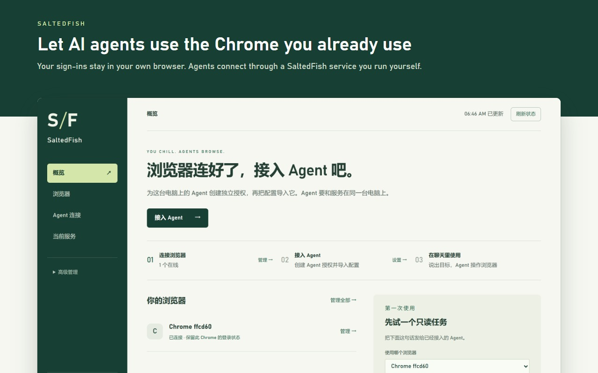
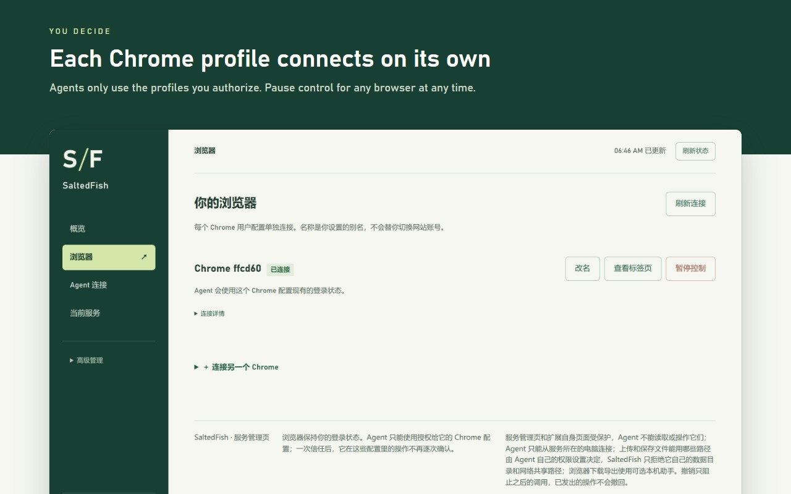
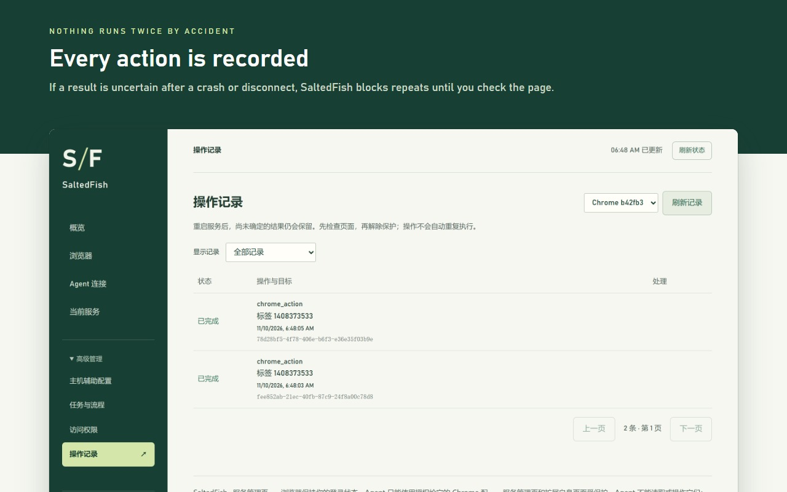

# SaltedFish

<p align="center">
  
</p>

<p align="center">
  <a href="https://www.npmjs.com/package/saltedfish"></a>
  <a href="https://github.com/finmoor/saltedfish/actions/workflows/ci.yml"></a>
  
  
  <a href="LICENSE"></a>
</p>

<p align="center">
  <b>中文</b> · <a href="README.en.md">English</a> · <a href="#快速开始">快速开始</a> · <a href="docs/npm.md">安装与运维</a> · <a href="docs/interaction.md">工具语义</a> · <a href="docs/architecture.md">架构</a>
</p>

SaltedFish 是一个不设限的浏览器工具：让任何支持 MCP 的 AI Agent 直接用**你正在用的 Chrome**。Agent 在服务器上，也能操作你电脑上的浏览器。

## 为什么用 SaltedFish

ChatGPT、Claude、WorkBuddy 自带的插件也能用你的登录状态，但只服务自家的 Agent，还限定能碰哪些网站。SaltedFish 是你自己运行的工具：

<table>
<tr>
<td width="50%" valign="top">

**不设限**

没有网站名单，不替你拦动作。能碰什么、做到哪一步，只看你的授权。

</td>
<td width="50%" valign="top">

**服务器上的 Agent，直接操作你电脑上的 Chrome**

无头服务器不用装浏览器、不用登录。Agent 在服务器上跑，点的是你桌面 Chrome 里已登录的网页。多台电脑的 Chrome 都能接进来，按名字调用。

</td>
</tr>
<tr>
<td valign="top">

**模拟真人操作**

用的是你真实的浏览器和账号环境。鼠标走曲线、点击有停顿、短文本逐键输入，不往页面里加东西，降低被风控封号的风险。

</td>
<td valign="top">

**不绑定 Agent 和模型**

任何支持 MCP 的 Agent 都能接，一条命令接好八种。几个 Agent 可以同时用。

</td>
</tr>
</table>

| | 厂商自带插件 | 自动化浏览器 | SaltedFish |
| --- | --- | --- | --- |
| 能碰的网站 | 厂商定，有的默认屏蔽金融类 | 不限 | 不限，由你授权 |
| Agent 在服务器上 | 不支持 | 浏览器也得在服务器上 | 直接操作你电脑上的 Chrome |
| 登录状态 | 有 | 没有 | 有 |
| 能接的 Agent | 只有自家 | 看框架 | 任何 MCP 客户端 |
| 多个 Agent 同时用 | 只有自家一个 | 各起各的 | 各自授权、各自标签组 |

该有的也都有：

- **多账号不串号**：每个 Chrome 配置单独配对；配置离线就报错，不会换号执行。
- **不打扰你**：Agent 在后台标签页操作，标签页收在自己的标签组里。
- **不重放**：结果不明的写操作会挡住后续写入，提交、付款不会自动重试。
- **省 token**：动作结果带页面变化；`chrome_batch` 一次跑完多步。
- **数据在你手里**：自己运行，不发遥测；每个 Agent 可限定配置、只读、随时撤销。

## 快速开始

需要 Node.js 24+ 和 Chrome。当前版本 **0.3.28**。

```sh
npm install -g saltedfish
saltedfish install
```

`install` 启动服务、接入本机 Agent，并打印扩展目录。然后：

1. **装扩展**：在 `chrome://extensions` 开启“开发者模式”，“加载已解压的扩展程序”，选打印出的目录。
2. **配对**：`saltedfish dashboard` 打开管理页，在“浏览器”里生成配对码，粘贴到扩展里。
3. **开始用**：在 Agent 里新开一个会话，例如：

> 使用 SaltedFish。先列出浏览器配置，找到“工作”，只操作这个配置。新开一个标签页完成任务，最后核对页面结果。

### 让服务器上的 Agent 操作你电脑上的 Chrome

在 Linux 服务器上运行同样两条命令（默认监听内网 IP 的 18445 端口），再运行 `saltedfish dashboard`。在你的电脑上打开它打印的链接，生成配对码，下载扩展，加载到 Chrome 里并粘贴配对码。

Agent 要和服务装在同一台电脑上。内网用的是不加密的 HTTP，跨公网要配证书，见 [安装与运维](docs/npm.md)。

### 常用命令

```sh
saltedfish status          # 服务状态
saltedfish dashboard       # 打开管理页（一次性登录码，5 分钟有效）
saltedfish connect         # 接入本机 Agent；--clients 指定范围，--trust-browser 设为免逐次确认
saltedfish upgrade         # 下载新版并切换，失败自动回退
saltedfish rollback        # 切回上一兼容版本
saltedfish logs --lines 100
```

## 它怎么工作



Agent 连服务的 MCP 入口，扩展主动连服务，服务负责授权、排队、记录和恢复。Windows 和 macOS 默认只监听本机；Linux 默认监听内网 IP，别的电脑上的 Chrome 可以连过来。Agent 的 `/mcp` 只接受服务所在电脑上的连接。

## 交给 Agent

1. `chrome_profiles` 找到配置，`chrome_tabs` 看有哪些标签页。
2. 写操作只能在本会话的标签组里：`chrome_new_tab` 开的标签页直接用，已有的先 `chrome_claim_tab` 接管。读不受限。
3. `chrome_inspect`、`chrome_find` 读页面、找元素，`chrome_action` 点击和输入。结果里的 `pageChange` 看得出结果，就不用再读一次页面。
4. 确定的多步操作交给 `chrome_batch`，失败即停。

<details>
<summary><code>chrome_batch</code> 示例</summary>

```json
{
  "profileId": "明确选择的配置 ID",
  "tabId": 123,
  "steps": [
    { "operation": "page.action", "args": { "action": "fill", "selector": "#name", "text": "示例名称" } },
    { "operation": "page.action", "args": { "action": "click", "selector": "#preview" } },
    { "operation": "page.wait", "args": { "selector": ".preview-ready" } }
  ],
  "timeoutMs": 60000
}
```

</details>

点击完成只代表输入事件发出去了，业务是否成功要看页面或网络结果。

工具共 64 个，默认列出 46 个，其余在管理页给 Agent 打开“高级工具”后出现。schema 见 [src/tools.ts](src/tools.ts)，行为细节见 [浏览器工具语义](docs/interaction.md)。

## 管理页

配对浏览器、给 Agent 授权、看标签组和操作记录，都在 `saltedfish dashboard`。详见 [管理页功能](docs/product-features.md)。

<table>
<tr>
<td width="33%"></td>
<td width="33%"></td>
<td width="33%"></td>
</tr>
<tr>
<td align="center">概览</td>
<td align="center">浏览器</td>
<td align="center">操作记录</td>
</tr>
</table>

## 能力

| 能力 | 说明 |
| --- | --- |
| 多配置 | `profileId + tabId` 显式路由；每个 Chrome 配置一个持久身份 |
| 协作 | 每个 Agent 独立授权，可限定配置、设为只读、随时撤销；标签组、标签页租约、同窗口视觉动作排队 |
| 页面 | 文字、元素、无障碍树、截图、页面脚本、Chrome 扩展可用的 CDP；导航前注入脚本（`initScript`） |
| 复杂界面 | open Shadow DOM、同源与跨源 iframe、JavaScript 弹窗、样式化下拉 |
| 网络与文件 | 网络事件、响应体、等待接口返回、上传、下载与完成状态 |
| 输入 | Agent 光标画在页面之外；可选拟人输入（鼠标轨迹、逐键输入），兼容依赖悬停、按住、拖拽时序的页面 |
| 恢复 | 操作派发前写入 SQLite；进程被强杀或重启后保护仍在 |
| 长结果 | 大 JSON 和图片落盘，分页读取 |
| 用户接管 | 扩展里可以暂停；在 Chrome 里手动停止调试会暂停连接，不自动重新接管 |
| 升级 | `saltedfish upgrade` 切换失败自动回退；手动加载的扩展在设置页一键更新，配对保留 |

## 安全与数据

- 服务验证 Host、Origin 和凭据。扩展和服务之间是双向挑战应答，配对密钥不在线上传输。
- 授权限制的是本服务的接口，不是操作系统沙箱。被授权的 Agent 能在获准的配置里以已登录的身份点击、输入、读取页面、执行页面脚本；开了一次信任后不再逐次确认。只给需要的配置授权，用完可以撤销。
- 非管理员 Agent 不能读写 SaltedFish 的数据目录和网络共享路径，不能打开 `file:` 地址，不能操作管理页；本机其他文件能不能读写由 Agent 自己的权限设置决定。
- 不发送遥测。工具返回的页面内容、截图会交给调用它的 Agent，由那个 Agent 和它所用的模型服务处理。
- 操作记录只存工具名、目标、时间和状态，不存脚本、页面正文和文件内容。

细节见 [隐私说明](PRIVACY.md)、[一次信任](docs/once-trust.md)、[限制与数据说明](docs/beta-limitations.md)。发现漏洞请按 [SECURITY.md](SECURITY.md) 私下报告。

## 已知限制

- 已在 Windows 和 Linux 上验证；macOS 没有验证分发。
- 不设限说的是 SaltedFish 这个工具；Agent 所用模型和客户端自己的规则、审批不归它管。
- Chrome 内部页面、其他扩展的页面、系统原生窗口、验证码和系统授权对话框没有自动化保证。
- 网页能观察到 DOM 和输入事件；不承诺网站识别不出自动化操作。
- Agent 连着时，Chrome 每个标签页顶部有一条“正在调试此浏览器”的提示条。Chrome 启动时带 `--silent-debugger-extension-api` 可以去掉，代价见 [安装与运维](docs/npm.md)。
- Chrome 的调试接口可能和 DevTools、其他扩展冲突，部分 CDP 域不能通过扩展使用。
- 已经发出去的动作撤不回来。任务运行时手动改网页可能影响结果，手动接管前先在扩展里暂停。

## 文档

- [安装与运维](docs/npm.md) · [支持的 Agent](docs/supported-clients.md) · [各客户端的配置细节](docs/client-compatibility.md)
- [管理页功能](docs/product-features.md) · [一次信任](docs/once-trust.md) · [浏览器工具语义](docs/interaction.md)
- [架构](docs/architecture.md) · [测试](docs/testing.md) · [名称与兼容](docs/branding.md) · [开源复用比较](docs/reuse.md)

## 参与开发

见 [CONTRIBUTING.md](CONTRIBUTING.md)。

```sh
npm ci
npm run build
npm run typecheck
npm test
```

## 许可

[MIT](LICENSE)。第三方依赖的许可见 [THIRD_PARTY_NOTICES.md](THIRD_PARTY_NOTICES.md)。
